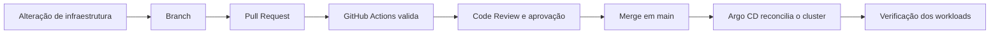
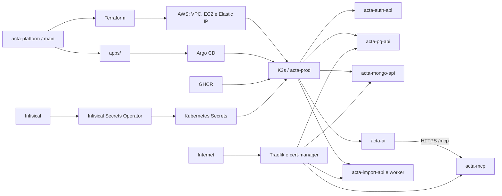

# ☁️ ACTA Platform

Infraestrutura como código e configuração GitOps do ACTA para hospedar, orquestrar e publicar os serviços que sustentam o ciclo **PDCA** (*Plan, Do, Check, Act*).

## 📌 Visão geral

O `acta-platform` centraliza o estado desejado da infraestrutura de produção. O repositório provisiona uma instância EC2 na AWS com Terraform, instala K3s e componentes operacionais, e mantém manifests Kubernetes consumidos pelo Argo CD.

O fluxo separa duas responsabilidades:

1. o Terraform cria a rede, a instância EC2 e o acesso ao cluster;
2. o Argo CD acompanha a pasta [`apps/`](apps/) na branch `main` e reconcilia os workloads no namespace `acta-prod`.

O estado GitOps inclui AI, MCP, as APIs e o worker de importação. O deploy publica os serviços em hosts `acta-*` derivados do Elastic IP e configura o AI para acessar o MCP em `https://acta-mcp.<ip-com-hifens>.sslip.io/mcp`. As imagens e os segredos necessários devem estar disponíveis no GHCR e no Infisical.

## ✨ Capacidades

- Provisionamento de VPC, subnet pública, tabela de rotas, Security Group, EC2, volume GP3 criptografado e Elastic IP na AWS.
- Instalação de K3s, Argo CD, cert-manager, Helm e Infisical Secrets Operator.
- Orquestração de APIs e worker com Deployments, Services, probes e limites de recursos.
- Exposição HTTPS pelo Traefik com certificados emitidos pelo Let's Encrypt.
- Sincronização GitOps automatizada com `prune` e `selfHeal` pelo Argo CD.
- Entrega de segredos do Infisical para Secrets do Kubernetes sem versionar seus valores no Git.
- Validação de Terraform, Kustomize, schemas Kubernetes e estrutura da Application do Argo CD no GitHub Actions.
- Script PowerShell para conduzir o provisionamento, bootstrap, configuração do GitOps e verificações finais.

## 🛠️ Tecnologias

| Tecnologia | Uso |
| --- | --- |
| AWS | Hospedagem da rede e da instância EC2 |
| Terraform 1.13.3 | Provisionamento da infraestrutura como código |
| Docker e GHCR | Empacotamento e distribuição das imagens dos serviços |
| K3s / Kubernetes | Orquestração dos containers |
| Kustomize | Composição dos manifests do ambiente de produção |
| Argo CD 3.5.2 | Reconciliação GitOps do estado declarado no Git |
| Traefik | Entrada HTTP e HTTPS no cluster |
| cert-manager 1.21.2 | Emissão e renovação de certificados TLS |
| Infisical Secrets Operator 0.10.11 | Sincronização de segredos com o cluster |
| Kubeconform 0.6.7 | Validação dos schemas Kubernetes na CI |
| yq 4.52.1 | Validação estrutural da Application do Argo CD |
| GitHub Actions | Validação contínua da infraestrutura |

## ✅ Pré-requisitos e configuração

Para executar o processo de provisionamento, é necessário ter:

- conta e credenciais AWS com permissão para os recursos definidos no Terraform;
- AWS CLI, Terraform, OpenSSH e `kubectl` disponíveis no PowerShell;
- um EC2 Key Pair existente na região escolhida e sua chave privada local;
- um IPv4 administrativo informado como bloco `/32`;
- credenciais Universal Auth e projeto configurado no Infisical;
- imagens dos serviços publicadas no GHCR.

Crie `infra/aws/terraform.tfvars` somente no ambiente local:

```hcl
aws_region   = "sa-east-1"
key_name     = "nome-do-key-pair"
admin_cidr   = "203.0.113.10/32"
instance_type = "t3.large"
```

O arquivo `terraform.tfvars`, estados, planos, credenciais AWS e chaves privadas são ignorados pelo Git. Nunca versione esses arquivos.

Os manifests `InfisicalSecret` contêm somente referências. Os valores reais de banco, Firebase, Cloudinary, Redis e tokens devem permanecer no Infisical. Antes de sincronizar Auth API, AI e MCP, confirme que os caminhos planejados e os nomes referenciados existem no projeto Infisical autorizado. Não copie valores para o Git ou para a documentação.

## 🧪 Validação local

Formate e valide o Terraform sem criar recursos:

```powershell
terraform -chdir=infra/aws fmt -check
terraform -chdir=infra/aws init -backend=false -input=false
terraform -chdir=infra/aws validate
```

Renderize os manifests e confira a estrutura produzida pelo Kustomize:

```powershell
kubectl kustomize apps
```

Esses comandos verificam formatação e configuração estática. Eles não confirmam acesso à AWS, criação dos recursos, sincronização do Argo CD ou saúde das aplicações.

## 🚀 Provisionamento e implantação

> [!CAUTION]
> O processo cria recursos cobráveis na AWS. Revise o `terraform plan`, a conta selecionada, a região e os custos antes de confirmar a aplicação.

O procedimento detalhado, incluindo pré-requisitos, verificações e diagnóstico, está em [`PASSO_A_PASSO.md`](PASSO_A_PASSO.md). Na raiz do repositório, execute:

```powershell
.\infra\aws\deploy.ps1
```

O script:

1. confirma a identidade AWS e executa `terraform init`, `validate` e `plan`;
2. exige a confirmação textual `APLICAR` antes do `terraform apply`;
3. aguarda o SSH e executa [`bootstrap-k3s.sh`](infra/aws/bootstrap-k3s.sh) na EC2;
4. instala K3s, Argo CD, cert-manager e o operador do Infisical;
5. cria o Secret de autenticação do Infisical a partir de entradas interativas;
6. aplica [`argocd/prod.yaml`](argocd/prod.yaml) e ajusta os hosts `sslip.io` ao Elastic IP;
7. aguarda sincronização, workloads e certificados;
8. consulta os endpoints públicos da Auth API, PG API, Mongo API, Import API e a rota `/health` do MCP e exibe o endereço `/mcp` do MCP.

O kubeconfig obtido do servidor é salvo em `~/.kube/acta-aws.yaml`. A chave privada esperada pelo script fica em `$env:USERPROFILE\.aws\labsuser.pem`; esse caminho é local e está ignorado pelo Git.

## 🔄 Fluxo GitOps e contribuição



O fluxo esperado para mudanças é:

1. criar uma branch e alterar somente os manifests ou o Terraform necessários;
2. abrir uma Pull Request usando o template do repositório;
3. aguardar a pipeline `teste-infra` e solicitar Code Review;
4. obter a aprovação definida pela equipe antes do merge;
5. após o merge em `main`, acompanhar a reconciliação do Argo CD e verificar os workloads.

O Argo CD usa `prune` para remover recursos excluídos do estado desejado e `selfHeal` para corrigir divergências no cluster. Por isso, alterações manuais em recursos gerenciados podem ser revertidas automaticamente.

## 🧩 Serviços orquestrados

A Auth API está configurada em [`apps/auth-api.yaml`](apps/auth-api.yaml), com segredos no caminho `/auth-api` do Infisical e o Secret Firebase mantido pela PG API. A FCM está configurada em [`apps/fcm-api.yaml`](apps/fcm-api.yaml) e [`apps/fcm-lembretes.yaml`](apps/fcm-lembretes.yaml): API e CronJob compartilham a imagem, as referências de banco e o Secret Firebase mantido pela PG API. A API define uma réplica e o CronJob permanece suspenso até validar os lembretes. Consulte a [sequência de publicação e operação](PASSO_A_PASSO.md#-publicação-e-operação-da-fcm).

| Componente | Porta | Verificação de disponibilidade |
| --- | ---: | --- |
| `acta-ai` | 8200 | `GET /health` (público via Ingress `acta-ai`) |
| `acta-mcp` | 8000 | `GET /health` público; protocolo MCP em `/mcp` |
| `acta-auth-api` | 8080 | `GET /api/v1/health`; autenticação Firebase, onboarding e convites |
| `acta-pg-api` | 8080 | `GET /api/v1/health` |
| `acta-mongo-api` | 8081 | `GET /api/v1/health` |
| `acta-import-api` | 8000 | `GET /docs` |
| `acta-import-worker` | — | Processo RQ sem Service HTTP |
| `acta-fcm-api` (preparação) | 8082 | `GET /health` verifica somente o processo |
| `acta-fcm-lembretes` (suspenso) | — | Job diário às 09h em `America/Sao_Paulo` |

O host FCM é `https://acta-fcm-api.<ip-com-hifens>.sslip.io`. Somente `/api/v1/me` e seus subcaminhos e `/health` são expostos. Produtores usam `http://acta-fcm-api.acta-prod.svc.cluster.local:8082/internal/v1/eventos` com `X-Internal-Token`; integrações de domínio não fazem parte desta preparação. OpenAPI, `/docs` e `/redoc` ficam internos, acessíveis por port-forward autorizado.

Os manifests das APIs Auth, PG, Mongo e Import e do worker definem requests e limits de CPU/memória. A Auth API usa o Secret `firebase-admin` fornecido pela configuração da PG API e recebe as credenciais próprias de banco, Firebase e Brevo pelo caminho `/auth-api` no Infisical. O endereço público da Auth API é `https://acta-auth-api.<ip-com-hifens>.sslip.io`; o script de implantação também configura esse endereço em `EXTERNAL_URL` para compor os links do logotipo nos convites. AI e MCP têm Services internos e probes; o AI também é publicado pelo Ingress `acta-ai`. Durante a implantação, `infra/aws/deploy.ps1` deriva os hosts públicos do IP do Terraform e configura `ACTA_MCP_URL` no Deployment do AI para `https://acta-mcp.<ip-com-hifens>.sslip.io/mcp`. O cliente AI envia a chave Bearer configurada e o contexto de usuário/empresa esperado pelo MCP.

O planejamento da infraestrutura e das cotas gratuitas de PostgreSQL, MongoDB, Redis e Qdrant, incluindo as premissas usadas no orçamento AWS Education, está em [`PLANO_DE_CUSTOS.md`](PLANO_DE_CUSTOS.md).

## 🔐 Segredos e acesso de rede

- SSH e a API Kubernetes são limitados ao `admin_cidr` configurado.
- HTTP e HTTPS são públicos nas portas 80 e 443.
- A instância exige IMDSv2 e usa volume raiz criptografado.
- As credenciais Universal Auth são criadas diretamente no cluster durante o deploy.
- O Infisical sincroniza os valores para Secrets do namespace `acta-prod` e pode reiniciar os pods quando houver atualização.

O repositório não deve receber chaves PEM, credenciais AWS, arquivos de estado do Terraform ou valores reais de segredos.

## 🏗️ Arquitetura



Terraform prepara a infraestrutura e o cluster. Ele não substitui o Argo CD: o Argo CD é responsável por manter os workloads iguais ao estado versionado em `main`.

## 📁 Estrutura

```text
.
├── .github/workflows/
│   └── teste-infra.yml       # CI de validação da infraestrutura
├── apps/
│   ├── config/               # referências de segredos no Infisical
│   ├── ai.yaml, mcp.yaml     # Deployments e Services de AI/MCP
│   ├── *-api.yaml            # Deployments e Services
│   ├── ingress.yaml          # HTTPS, hosts e certificados
│   └── kustomization.yaml    # agrega o estado de produção
├── argocd/
│   └── prod.yaml             # Application do ambiente acta-prod
├── infra/aws/
│   ├── main.tf               # rede, segurança, EC2 e Elastic IP
│   ├── variables.tf          # entradas e validações do Terraform
│   ├── output.tf             # IP, instância, SSH e URLs
│   ├── deploy.ps1            # orquestra o provisionamento e deploy
│   └── bootstrap-k3s.sh      # instala componentes no cluster
├── PLANO_DE_CUSTOS.md        # arquitetura planejada e orçamento mensal
├── PULL_REQUEST_TEMPLATE.md
└── README.md
```

## 🤝 Links e autoria

- [Repositório](https://github.com/AppActa/acta-platform) · [Licença MIT](LICENSE) · `acta.institutojef@gmail.com`
- Contribuições: use *issues* e *pull requests*; há um [`PULL_REQUEST_TEMPLATE.md`](PULL_REQUEST_TEMPLATE.md).
- Autoria: Equipe ACTA.